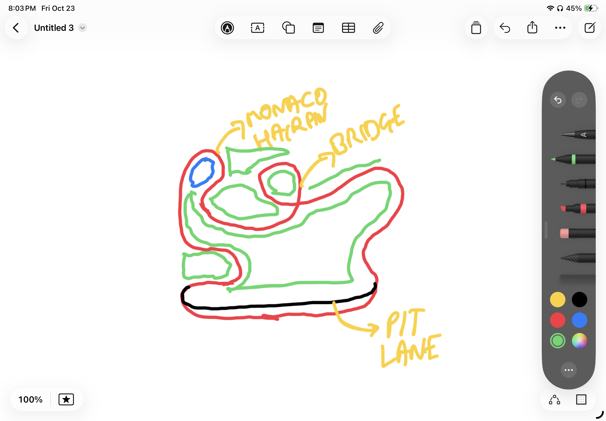

# henil.dev

My portfolio. It opens with a terminal where Claude tells you who I am, then turns into an F1 pit wall: my story told in laps, work history on a timing tower, and a 3D car you can drive around a circuit where each corner is a chapter.

- `/` the pit wall: terminal intro, story, work, projects, AI playbook, side quest, research, contact
- `/drive` a playable 3D circuit (React Three Fiber)
- `/resume` one page, no animations, prints well
- `/api/radio` streaming answers about me from Groq, as Claude in the terminal or as my race engineer on team radio
- `/mcp` an MCP server. `claude mcp add --transport http henil https://<site>/mcp`

## Run it

```bash
npm install
cp .env.example .env.local   # add a GROQ_API_KEY for live answers
npm run dev
```

All content lives in `content/`. Edit those files and the page, the resume, the radio and the MCP server all update together.

## Next: track layout v5 (my sketch, 2026-10-23)



Red is the circuit, black the pit lane, green grass and infield, blue water. This is the next thing to build in the 3D world (`components/world/layout.ts` `TRACK_POINTS`, `PIT`, `pitRoadCurves`), one change per commit, screenshots each time (docs/ROADMAP.md has the working rules).

What the sketch asks for:

1. **Monaco hairpin, top left (north-west).** A tight 180° hairpin wrapped round a small pond. Coming up the west side the road climbs into it, turns right round the pond and comes back out heading east/south-east on the inside.
2. **Pit lane like a real one.** A separate lane running inside the whole main straight (the bottom), parallel to it, joining the track only at each end: in at the start of the straight, out at the end. Pit wall between the two, garages along the lane's inner side.
3. **The rest of the lap, in order** (same direction as today, the straight runs east):
   - end of the straight, bottom right: up the east side with an S (out, in, out), to a big right-hander at the top right;
   - a long sweep west along the top towards the middle;
   - **the bridge**, top middle: a small loop where the road crosses itself (keep the crossover), round a grass island;
   - on west past a big grass area in the middle-left, into the Monaco hairpin (1);
   - down the west side, a chicane round a grass block at the bottom left, onto the straight.
4. **Redistribute.** Places, sector scenes, the garden, the timeline, the name and the park islands move where they fit best inside the new shape. The start stays in front of the name, with a lane that leads onto the circuit (`components/world/access.ts`), rerouted to the new pit exit.

Open questions to settle before building: where the river and harbour go (they cross today's east esses and west sweepers), and which grass area takes which place.

## Stack

Next.js 16, React 19, Tailwind 4, React Three Fiber, Framer Motion, Groq. Deployed as a Docker container behind Caddy on Oracle Cloud. See [deploy/DEPLOY.md](deploy/DEPLOY.md).

## Credits

The vehicle feel and follow camera are adapted from [Bruno Simon's folio-2025](https://github.com/brunosimon/folio-2025) (MIT, © 2025 Bruno Simon): suspension damping ratios, centre-of-mass setup, soft top speed and the single-pass camera smoothing.

Music, sound effects and the race engineer's voice are generated with [ElevenLabs](https://elevenlabs.io) (`scripts/gen-audio.mjs`).
